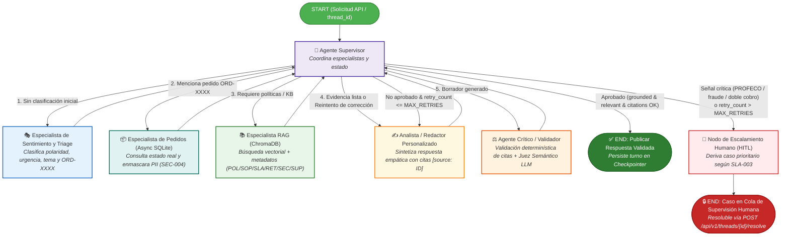

# 🧠 The Intelligence System — Sistema Multi-Agente RAG de Grado de Producción

[](#requisitos)
[](#interfaz-de-api-profesional)
[](#arquitectura-y-diagrama-de-flujo-del-grafo-de-agentes)
[](#estrategia-rag-avanzado)
[](#observabilidad-y-trazabilidad-en-arize-phoenix)
[](#validacion-estricta-con-pydantic-v2)

**The Intelligence System** es un sistema de Inteligencia Artificial de grado de producción para **Atención al Cliente, Gestión de Pedidos y Cumplimiento de Políticas en E-Commerce**. Ensambla y unifica en una arquitectura 100% asíncrona los componentes desarrollados a lo largo del programa:

1. **Cimientos Asíncronos & API Profesional (`FastAPI` + `uvicorn` + `httpx` + `aiosqlite`)**: Endpoints `async def` sin llamadas bloqueantes, soporte de streaming Server-Sent Events (SSE) y documentación interactiva OpenAPI/Swagger.
2. **RAG Avanzado (`ChromaDB` + `RecursiveCharacterTextSplitter` + `tiktoken`)**: Ingesta con conteo real de tokens (`CHUNK_SIZE=500`, `CHUNK_OVERLAP=50`), enriquecimiento de metadatos documentales (`POL-001`, `SOP-002`, `SLA-003`, `SEC-004`, `RET-005`, `SUP-006`) y recuperación ejecutada fuera del event loop (`asyncio.to_thread`).
3. **Inteligencia Colectiva con Supervisor (`LangGraph`)**: Topología jerárquica **Supervisor–Workers** donde un agente **Supervisor** coordina de forma autónoma a especialistas de **Sentimiento y Triage**, **Consulta Operativa de Pedidos**, **Recuperación RAG**, **Analista/Redactor** y **Crítico/Validador**, incluyendo un ciclo controlado de reparación (`retry`) y freno de seguridad hacia **Soporte Humano (`human_escalation`)**.
4. **Persistencia de Conversaciones (`Checkpointer` de LangGraph)**: Implementa `AsyncSqliteSaver` (persistencia local en disco `./storage/checkpoints.sqlite` que sobrevive reinicios del servidor sin requerir contenedores externos) y `AsyncRedisCheckpointer` (para despliegues distribuidos con Redis).
5. **Validación Estricta (`Pydantic v2`)**: Contratos tipados con `ConfigDict(extra="forbid")` tanto en entradas/salidas de la API como en todas las herramientas y estados de los agentes.
6. **Observabilidad Completa (`Arize Phoenix` + `OpenTelemetry` / `OpenInference`)**: Instrumentación automática y spans personalizados por agente y herramienta, registrando latencias desglosadas, uso de tokens, costo estimado y evaluaciones de grounding.

---

## 🏗️ Arquitectura y Diagrama de Flujo del Grafo de Agentes

El sistema implementa una topología **Supervisor–Workers con ciclo de validación y freno de seguridad** en LangGraph (`src/intelligence_system/graph.py`):



### Matriz de Decisión del Supervisor

| Condición evaluada en `IntelligenceState` | Destino del Supervisor | Justificación arquitectónica |
|---|---|---|
| `triage is None` | `triage_specialist` | Analiza sentimiento, urgencia, categoría, señales de escalamiento y extrae `order_id`. |
| `triage.needs_order_lookup` y `order_info is None` | `order_specialist` | Verifica en `orders.sqlite` (`aiosqlite`) el estado real del pedido sin inventar fechas (`SOP-002`). |
| `rag_completed is False` | `rag_specialist` | Recupera fragmentos relevantes de `ChromaDB` con `asyncio.to_thread`. |
| `answer == ""` | `analyst_drafter` | Genera (o repara) el borrador citando `[source: ID]` y respetando el historial del `Checkpointer`. |
| `review is None` | `critic_validator` | Ejecuta `validate_citations` (determinístico) + evaluación semántica `GroundingReview`. |
| `triage.escalation_required == True` | `human_escalation` | Escalamiento obligatorio ante disputas legales/PROFECO, fraude o doble cobro (`SLA-003`). |
| `review.approved == True` | `FINISH` (`END`) | La respuesta está fundamentada, cita fuentes válidas y cumple políticas. |
| `review.approved == False` y `retry_count <= MAX_VALIDATION_RETRIES` | `analyst_drafter` | **Ciclo de autoreparación**: inyecta `validation_error` al Analista para corregir citas o afirmaciones. |
| `review.approved == False` y `retry_count > MAX_VALIDATION_RETRIES` | `human_escalation` | **Freno de seguridad** contra bucles infinitos. |

---

## 📁 Estructura Unificada del Proyecto

```text
intelligence-system/
├── .env.example                        # Plantilla de variables de entorno (sin secretos hard-codeados)
├── .gitignore                          # Exclusión de .env, .venv y bases locales
├── Dockerfile                          # Imagen Python 3.12 para despliegue en contenedor
├── docker-compose.yml                  # Orquestación opcional: API + Arize Phoenix + Redis
├── pyproject.toml                      # Metadatos del paquete Python 3.12+ y configuración pytest
├── requirements.txt                    # Dependencias de producción fijadas
├── run.sh                              # Script de despliegue local en una sola instrucción
├── data/
│   └── knowledge_base/                 # Corpus documental Markdown con metadatos YAML
│       ├── POL-001_politica_devoluciones.md
│       ├── SOP-002_consulta_pedidos.md
│       ├── SLA-003_atencion_quejas_escalamiento.md
│       ├── SEC-004_proteccion_datos_seguridad.md
│       ├── RET-005_plazos_reembolsos.md
│       └── SUP-006_incidencias_tecnicas_respaldos.md
├── evidencias/                         # Diagramas y capturas de trazas en Arize Phoenix
│   ├── README.md
│   └── arquitectura_trazas.png
├── results/                            # Métricas reales exportadas por las pruebas (summary.csv, runs.jsonl)
├── scripts/
│   └── run_observability_eval.py       # Ejecuta los 5 escenarios de prueba y envía trazas a Phoenix
├── src/
│   └── intelligence_system/
│       ├── __init__.py
│       ├── config.py                   # Settings con pydantic-settings (0 hard-coding)
│       ├── schemas.py                  # Modelos Pydantic v2 para API, herramientas y agentes
│       ├── observability.py            # Configuración OpenTelemetry / OpenInference -> Arize Phoenix
│       ├── checkpointer.py             # AsyncSqliteSaver (disco) y AsyncRedisCheckpointer (Redis)
│       ├── database.py                 # Repositorio asíncrono de pedidos (aiosqlite) + máscara PII
│       ├── rag.py                      # AsyncRAGManager (ChromaDB + tiktoken + asyncio.to_thread)
│       ├── validation.py               # Validación determinística de citas [source: ID]
│       ├── tools.py                    # Herramientas asíncronas validadas con Pydantic
│       ├── graph.py                    # Grafo StateGraph Multi-Agente con Supervisor
│       └── api.py                      # Aplicación FastAPI asíncrona + SSE streaming + HITL
└── tests/
    └── test_system.py                  # Suite pytest-asyncio (RAG, Pydantic, ciclo retry, persistencia)
```

---

## 🚀 Despliegue Local en Una Sola Instrucción

### Requisitos
- **Python 3.12+**
- Clave `OPENAI_API_KEY` configurada en `.env` (con acceso a `gpt-4o-mini` y `text-embedding-3-small`).

### Opción A: Script Unificado `./run.sh` (Recomendado en macOS / Linux)

1. Configura tu archivo `.env` a partir de la plantilla:
   ```bash
   cp .env.example .env
   # Edita .env y coloca tu OPENAI_API_KEY=sk-...
   ```
2. Levanta todo el sistema con **una sola instrucción**:
   ```bash
   chmod +x run.sh
   ./run.sh
   ```
   ¿Qué hace `./run.sh` automáticamente?
   - Crea y configura el entorno virtual Python 3.12 en `.venv/` e instala las dependencias.
   - Inicializa la base operativa asíncrona de pedidos (`storage/orders.sqlite`) y el índice vectorial ChromaDB (`storage/chroma`).
   - Levanta el servidor de observabilidad **Arize Phoenix** en segundo plano (`http://localhost:6006`).
   - Ejecuta las **5 pruebas de observabilidad** exportando trazas a Phoenix y métricas a `results/summary.csv` y `results/runs.jsonl`.
   - Levanta la API profesional **FastAPI** en `http://localhost:8000` (Swagger UI en `http://localhost:8000/docs`).

   También puedes ejecutar modos específicos:
   ```bash
   ./run.sh test     # Ejecuta la suite completa de pruebas unitarias e integración (pytest)
   ./run.sh eval     # Ejecuta únicamente las 5 pruebas de observabilidad hacia Arize Phoenix
   ./run.sh server   # Levanta Arize Phoenix (6006) + API FastAPI (8000)
   ```

### Opción B: Despliegue con Docker Compose

Si cuentas con Docker instalado, puedes levantar la API, Redis y Arize Phoenix con un solo comando:

```bash
cp .env.example .env
docker compose up --build
```

---

## 🌐 Interfaz de API Profesional (FastAPI)

Una vez levantado el servidor en `http://localhost:8000`, la documentación interactiva OpenAPI está disponible en:
- **Swagger UI**: <http://localhost:8000/docs>
- **ReDoc**: <http://localhost:8000/redoc>

### Endpoints Principales

| Método | Ruta | Descripción |
|---|---|---|
| `GET` | `/health` | Estado del sistema, backend del Checkpointer, fragmentos en ChromaDB y conexión a Phoenix. |
| `POST` | `/api/v1/chat` | Ejecuta el grafo Multi-Agente con Supervisor para un `thread_id`, devolviendo respuesta validada, citas, análisis de sentimiento, estado del pedido y métricas. |
| `POST` | `/api/v1/chat/stream` | Streaming **Server-Sent Events (SSE)** en tiempo real mostrando cada transición del Supervisor y sus especialistas. |
| `GET` | `/api/v1/threads/{thread_id}` | Recupera desde el **Checkpointer de LangGraph** el historial de mensajes y último estado persistido (sobrevive reinicios del servidor). |
| `POST` | `/api/v1/threads/{thread_id}/resolve` | Permite a un supervisor humano aprobar o resolver un caso escalado (**Human-in-the-Loop**). |
| `POST` | `/api/v1/ingest` | Re-indexa de forma asíncrona los documentos de `data/knowledge_base/` en ChromaDB. |
| `GET` | `/api/v1/orders/{order_id}` | Consulta directa asíncrona de un pedido verificado (`ORD-1001` a `ORD-1005`) con correo enmascarado. |

### Ejemplo de Uso con `curl`

```bash
# 1. Enviar una consulta que combina RAG + Consulta de Pedido + Supervisor
curl -X POST http://localhost:8000/api/v1/chat \
  -H "Content-Type: application/json" \
  -d '{
    "query": "Mi pedido ORD-1003 tiene devolución aprobada. ¿Cuál es su estado y cuánto tarda el reembolso? Cita las fuentes.",
    "thread_id": "sesion-cliente-1003",
    "customer_id": "CUST-03"
  }'

# 2. Verificar que la conversación quedó persistida en el Checkpointer de LangGraph
curl http://localhost:8000/api/v1/threads/sesion-cliente-1003
```

---

## 🔭 Observabilidad y Trazabilidad en Arize Phoenix

El módulo `src/intelligence_system/observability.py` instrumenta tanto LangChain/LangGraph (`LangChainInstrumentor`) como spans personalizados de OpenTelemetry bajo la traza raíz `multi_agent.request`:

- `agent.supervisor`: Decisiones de enrutamiento (`supervisor.next_agent`, `supervisor.rationale`, `supervisor.retry_count`).
- `agent.triage_sentiment`: Polaridad, tipo de incidencia, urgencia, detección de escalamiento y tokens del modelo.
- `agent.order_specialist` -> `tool.order_lookup`: Tiempo de consulta SQLite asíncrona, ID y estado del pedido.
- `agent.rag_specialist` -> `tool.vector_search` (`tool.query_embedding` + `tool.chroma_similarity_search`): Latencia de embeddings vs búsqueda vectorial y `retrieval.source_ids`.
- `agent.analyst`: Generación del borrador, versión de prompt (`app.prompt_version`) y conteo de tokens (`llm.input_tokens`, `llm.output_tokens`, `llm.total_tokens`).
- `agent.semantic_review`: Atributos de evaluación `eval.grounded`, `eval.relevant`, `eval.citation_valid` y `eval.unsupported_claim_count`.
- `agent.human_escalation`: Motivo de derivación a soporte humano según `SLA-003`.

### Las 5 Pruebas de Observabilidad Incluidas (`scripts/run_observability_eval.py`)

1. **Prueba 1 (RAG Puro — Devoluciones)**: Consulta requisitos, plazo de 30 días y excepciones (`POL-001`).
2. **Prueba 2 (RAG + Base de Pedidos `ORD-1003`)**: Verifica estado `refund_pending` (`SOP-002`) y plazos bancarios de 5 a 7 días hábiles (`RET-005`).
3. **Prueba 3 (RAG + Pedido Retrasado `ORD-1002`)**: Consulta último evento logístico en Monterrey, estados permitidos (`SOP-002`) y SLA de 24 horas (`SLA-003`).
4. **Prueba 4 (Multi-Turno en el mismo `thread_id` + Incidencia Técnica)**: Comprueba que el Checkpointer conserva el contexto del turno anterior y responde sobre diagnóstico técnico y respaldos incrementales cada 6 horas (`SUP-006`).
5. **Prueba 5 (Caso Crítico de Doble Cobro en `ORD-1005` + Amenaza PROFECO)**: Verifica que el Supervisor detecta la señal crítica y deriva automáticamente al nodo `human_escalation` (`SLA-003`, `RET-005`).

Además soporta banderas adicionales para inspección de casos borde:
```bash
PYTHONPATH=src .venv/bin/python scripts/run_observability_eval.py --out-of-scope
PYTHONPATH=src .venv/bin/python scripts/run_observability_eval.py --simulate-failure
```
